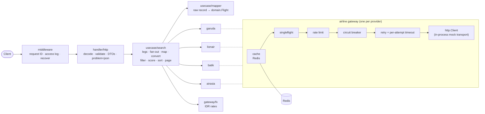

# bookcabin-assignment

[](https://github.com/faithol1024/bookcabin-assignment/actions/workflows/ci.yml)

Flight search and aggregation API in Go. It queries four mocked airline providers (Garuda Indonesia, Lion Air, Batik Air, AirAsia) in parallel, normalizes their four JSON formats into one model, converts foreign fares to IDR, and filters, sorts and ranks the results. One-way, round-trip and multi-city searches share one code path.

- [1. Quick start](#1-quick-start)
- [2. API usage](#2-api-usage)
- [3. Architecture](#3-architecture)
- [4. Design decisions](#4-design-decisions)
- [5. Data issues found](#5-data-issues-found)
- [6. Best-value score](#6-best-value-score)
- [7. Testing and benchmarks](#7-testing-and-benchmarks)
- [8. Assumptions, limitations and future work](#8-assumptions-limitations-and-future-work)
- [9. Configuration and secrets](#9-configuration-and-secrets)
- [10. Development setup](#10-development-setup)

## 1. Quick start

Needs Docker only.

```bash
docker compose up        # builds the API image, starts Redis, waits for both healthchecks
```

In another terminal:

```bash
curl -s -X POST localhost:8080/v1/flights/search \
  -H 'Content-Type: application/json' \
  -d '{"origin":"CGK","destination":"DPS","departureDate":"2025-12-15","returnDate":null,"passengers":1,"cabinClass":"economy"}'
```

Other endpoints: `POST /v1/flights/search/stream` (the same search as server-sent events, section 2.6) and `GET /healthz`. The full contract is in [`api/openapi.yaml`](api/openapi.yaml); the running service serves it at `GET /openapi.yaml` and as interactive Swagger UI at http://localhost:8080/docs (loaded from the jsDelivr CDN).

The mock data covers these routes and dates (all December 2025, economy):

| Route | Date | What it shows |
| --- | --- | --- |
| CGK → DPS | 15 | the 13 flights from the given provider files |
| CGK → DPS | 16 | flights on the next day, not in the 15th's results |
| DPS → CGK | 18 | return flights (round trip with CGK → DPS on the 15th) |
| DPS → SUB, SUB → CGK | 17, 19 | multi-city chain after CGK → DPS on the 15th |
| CGK → DJJ | 20 | WIT (+09:00) arrival |
| CGK → UPG | 20 | overnight flights |
| CGK → SUB | 21 | equal price and duration (ID tiebreaker) |
| CGK → SUB | 23 | only 2 seats left (hidden for 3+ passengers) |
| CGK → DPS | 24 | USD and SGD fares converted to IDR (`price.original`); an unsupported currency rejected |
| CGK → JOG | 22 | missing optional fields (`aircraft: null`, no amenities) |
| CGK → TTE | 22 | airport missing from the city table (`city: null`, `airport_unknown`) |
| CGK → LOP | 22 | unrecognised baggage text (`baggage_unparsed`) |
| CGK → KNO, CGK → BPN | 22 | arrival before departure / unparseable time: rejected, counted in `flights_rejected` |

## 2. API usage

All six examples below were run against `docker compose up`; outputs are trimmed with `jq`. `search_time_ms` differs between runs, and `cache_hit` depends on whether the same route and date was searched in the last 120 s.

### 2.1 One-way

```bash
curl -s -X POST localhost:8080/v1/flights/search -H 'Content-Type: application/json' \
  -d '{"origin":"CGK","destination":"DPS","departureDate":"2025-12-15","passengers":1,"cabinClass":"economy"}' \
  | jq '{search_criteria, metadata, first: .flights[0].id, ids: [.flights[].id]}'
```

```json
{
  "search_criteria": { "origin": "CGK", "destination": "DPS", "departure_date": "2025-12-15", "passengers": 1, "cabin_class": "economy" },
  "metadata": {
    "total_results": 13, "limit": 20, "offset": 0,
    "providers_queried": 4, "providers_succeeded": 4, "providers_failed": 0,
    "flights_rejected": 0,
    "cheapest_by_provider": { "AirAsia": 485000, "Batik Air": 950000, "Garuda Indonesia": 1250000, "Lion Air": 780000 },
    "search_time_ms": 338, "cache_hit": false, "provider_errors": []
  },
  "first": "QZ532_AirAsia",
  "ids": ["QZ532_AirAsia", "QZ524_AirAsia", "QZ520_AirAsia", "JT742_LionAir", "JT740_LionAir", "ID6514_BatikAir",
          "ID6520_BatikAir", "GA400_GarudaIndonesia", "QZ7250_AirAsia", "GA410_GarudaIndonesia", "JT650_LionAir",
          "ID7042_BatikAir", "GA315_GarudaIndonesia"]
}
```

With no `sort`, results are ranked by best value (section 6). AirAsia fails 10% of calls; a failed call is retried, and if all attempts fail the search still answers 200 with that provider in `provider_errors`.

### 2.2 Filters, sort and paging

Two passengers, at most Rp 1.000.000 per person, direct flights leaving between 05:00 and 12:00 local time, cheapest first, 3 per page:

```bash
curl -s -X POST localhost:8080/v1/flights/search -H 'Content-Type: application/json' -d '{
  "origin": "CGK", "destination": "DPS", "departureDate": "2025-12-15",
  "passengers": 2, "cabinClass": "economy",
  "filters": { "priceMax": 1000000, "maxStops": 0, "departureTime": { "from": "05:00", "to": "12:00" } },
  "sort": { "by": "price", "order": "asc" },
  "page": { "limit": 3 }
}' | jq '{total: .metadata.total_results, cache_hit: .metadata.cache_hit, flight: .flights[0]}'
```

```json
{
  "total": 3,
  "cache_hit": true,
  "flight": {
    "id": "QZ524_AirAsia",
    "provider": "AirAsia",
    "airline": { "name": "AirAsia", "code": "QZ" },
    "flight_number": "QZ524",
    "departure": { "airport": "CGK", "city": "Jakarta", "datetime": "2025-12-15T10:00:00+07:00", "timestamp": 1765767600 },
    "arrival": { "airport": "DPS", "city": "Denpasar", "datetime": "2025-12-15T12:45:00+08:00", "timestamp": 1765773900 },
    "duration": { "total_minutes": 105, "formatted": "1h 45m" },
    "stops": 0,
    "layovers": [],
    "price": {
      "amount": 720000, "currency": "IDR", "formatted": "Rp 720.000",
      "total": 1440000, "total_formatted": "Rp 1.440.000", "original": null
    },
    "available_seats": 54,
    "cabin_class": "economy",
    "aircraft": null,
    "amenities": [],
    "baggage": { "carry_on": "Cabin baggage only", "checked": "Additional fee" },
    "score": 0,
    "warnings": []
  }
}
```

Price filters and `amount` are per passenger; `total` is `amount × passengers`. Time windows wrap past midnight when `from > to` (`22:00`–`02:00`). The second search of the same route and date is served from cache (`cache_hit: true`).

### 2.3 Round trip

```bash
curl -s -X POST localhost:8080/v1/flights/search -H 'Content-Type: application/json' \
  -d '{"origin":"CGK","destination":"DPS","departureDate":"2025-12-15","returnDate":"2025-12-18","passengers":1,"cabinClass":"economy","page":{"limit":2}}' \
  | jq '{search_criteria, outbound: (.outbound | {origin, destination, date, total: .metadata.total_results, flights: [.flights[].id]}),
         inbound: (.inbound | {origin, destination, date, total: .metadata.total_results, flights: [.flights[].id]})}'
```

```json
{
  "search_criteria": { "origin": "CGK", "destination": "DPS", "departure_date": "2025-12-15", "return_date": "2025-12-18", "passengers": 1, "cabin_class": "economy" },
  "outbound": { "origin": "CGK", "destination": "DPS", "date": "2025-12-15", "total": 13, "flights": ["QZ532_AirAsia", "QZ524_AirAsia"] },
  "inbound": { "origin": "DPS", "destination": "CGK", "date": "2025-12-18", "total": 4, "flights": ["QZ7511_AirAsia", "ID6515_BatikAir"] }
}
```

Each leg is `{origin, destination, date, metadata, flights}` with its own paging, ranking and provider errors.

### 2.4 Multi-city

```bash
curl -s -X POST localhost:8080/v1/flights/search -H 'Content-Type: application/json' -d '{
  "legs": [
    { "origin": "CGK", "destination": "DPS", "date": "2025-12-15" },
    { "origin": "DPS", "destination": "SUB", "date": "2025-12-17" },
    { "origin": "SUB", "destination": "CGK", "date": "2025-12-19" }
  ],
  "passengers": 1, "cabinClass": "economy", "page": { "limit": 1 }
}' | jq '[.legs[] | {origin, destination, date, total: .metadata.total_results, best: .flights[0].id, price: .flights[0].price.formatted}]'
```

```json
[
  { "origin": "CGK", "destination": "DPS", "date": "2025-12-15", "total": 13, "best": "QZ532_AirAsia", "price": "Rp 595.000" },
  { "origin": "DPS", "destination": "SUB", "date": "2025-12-17", "total": 2, "best": "QZ7520_AirAsia", "price": "Rp 540.000" },
  { "origin": "SUB", "destination": "CGK", "date": "2025-12-19", "total": 2, "best": "JT573_LionAir", "price": "Rp 780.000" }
]
```

2 to 5 legs, dates non-decreasing, all legs searched in parallel. `legs` cannot be combined with `origin`, `destination`, `departureDate` or `returnDate`.

### 2.5 Validation error

Every problem is reported at once as RFC 9457 `application/problem+json`. A snake_case key gets a camelCase hint:

```bash
curl -s -i -X POST localhost:8080/v1/flights/search -H 'Content-Type: application/json' \
  -d '{"origin":"CGK","destination":"CGK","departure_date":"2025-12-15","passengers":1,"cabinClass":"economy"}'
```

```http
HTTP/1.1 400 Bad Request
Content-Type: application/problem+json
X-Request-Id: 60bca2dcf98c4128c6f5357a42d4e854

{"type":"validation_error","title":"Validation failed","status":400,"detail":"The request is invalid.","request_id":"60bca2dcf98c4128c6f5357a42d4e854","errors":[{"field":"departure_date","message":"unknown field; did you mean \"departureDate\"?"}]}
```

With the key fixed but other values wrong, the whole list comes back:

```bash
curl -s -X POST localhost:8080/v1/flights/search -H 'Content-Type: application/json' \
  -d '{"origin":"cgk","destination":"CGK","departureDate":"15-12-2025","passengers":0,"cabinClass":"premium","filters":{"priceMin":5,"priceMax":1},"sort":{"by":"cheapest"}}' \
  | jq '.errors'
```

```json
[
  { "field": "origin", "message": "must be a 3-letter upper-case IATA airport code" },
  { "field": "departureDate", "message": "must be a date as YYYY-MM-DD" },
  { "field": "passengers", "message": "must be between 1 and 9" },
  { "field": "cabinClass", "message": "must be one of economy, business, first" },
  { "field": "filters.priceMin", "message": "must not exceed filters.priceMax" },
  { "field": "sort.by", "message": "must be one of best_value, price, duration, departure, arrival" }
]
```

| Status | `type` | When |
| --- | --- | --- |
| 400 | `validation_error` | Malformed JSON, unknown field, bad IATA code/date/time window, origin = destination, `returnDate` before `departureDate`, legs out of range or out of order, passengers out of range, unknown cabin/sort key/order, `priceMin > priceMax`, negative filter values, `limit` outside 1–100, negative `offset` |
| 413 | `payload_too_large` | Body over 64 KB |
| 500 | `internal_error` | Recovered panic or unexpected error (details only in the logs, with the request ID) |
| 502 | `all_providers_failed` | Every provider failed on every leg |

Redis problems never produce an error response.

### 2.6 Streaming (server-sent events)

`POST /v1/flights/search/stream` takes the same body as `/v1/flights/search`, but sends each airline's flights the moment that airline answers instead of waiting for all four.

```bash
curl -sN -X POST localhost:8080/v1/flights/search/stream -H 'Content-Type: application/json' \
  -d '{"origin":"CGK","destination":"DPS","departureDate":"2025-12-15","passengers":1,"cabinClass":"economy"}' \
  | grep -E '^(event|data)' | sed 's/^data: //' \
  | jq -Rrc '. as $l | try (fromjson | if has("flights") then {leg, provider, ids: [.flights[].id]}
      elif has("metadata") then {leg, metadata: (.metadata | {total_results, providers_succeeded, providers_failed, cache_hit})}
      else . end | tojson) catch $l'
```

```text
event: flights
{"leg":0,"provider":"Lion Air","ids":["JT742_LionAir","JT650_LionAir","JT740_LionAir"]}
event: flights
{"leg":0,"provider":"Batik Air","ids":["ID6514_BatikAir","ID7042_BatikAir","ID6520_BatikAir"]}
event: flights
{"leg":0,"provider":"Garuda Indonesia","ids":["GA400_GarudaIndonesia","GA410_GarudaIndonesia","GA315_GarudaIndonesia"]}
event: flights
{"leg":0,"provider":"AirAsia","ids":["QZ532_AirAsia","QZ7250_AirAsia","QZ520_AirAsia","QZ524_AirAsia"]}
event: leg
{"leg":0,"metadata":{"total_results":13,"providers_succeeded":4,"providers_failed":0,"cache_hit":true}}
event: done
{}
```

| Event | Data | When |
| --- | --- | --- |
| `flights` | `leg` (index into the search's legs), `provider`, `flights` | Once per provider that answered, in arrival order |
| `leg` | `leg`, `origin`, `destination`, `date`, `metadata` (as in the JSON response) | Once per leg, after all its providers answered or its deadline passed |
| `done` | `{}` | Last event of a successful search |
| `error` | a problem detail (same body as the 502) | Instead of `done`, when every provider failed on every leg |

Each `flights` batch is filtered, scored and sorted on its own and is not paged, so `score` compares flights within one batch only; the client merges batches and re-sorts. Validation errors still come back as a plain 400/413 problem before the stream starts. Once streaming, the status is always 200.

## 3. Architecture



A search request becomes 1 to 5 legs. For each leg the usecase calls the four airline gateways in parallel under an 800 ms deadline, maps each raw record to `domain.Flight` (rejecting invalid ones), converts foreign fares to IDR, then filters, fills missing cities from a static IATA table, scores, sorts and pages. Legs run in parallel too.

```
cmd/
  app-http/          main.go (config → secrets → Redis ping → wiring → server), router.go,
                     handler.go (gateway + usecase wiring), cache.go (Redis connection)
  healthcheck/       tiny HTTP probe used by the Docker healthcheck (distroless has no curl)
internal/            flight-search code
  apperr/            shared sentinel errors
  config/            Config struct, strict parsing, validation of every value
  domain/            Flight, Money, Cabin, warnings, IDR and duration formatting
  gateway/           one package per external service, no shared code
    garuda/ lionair/ batik/ airasia/
                     client.go (plain HTTP client), mock.go (mock server, latency/failure constants),
                     response.go (raw provider records), mockdata/*.json (go:embed)
    fx/              plain mock call, no cache or resilience
  handler/http/      handlers, request validation, response DTOs, middleware, problem+json
  usecase/mapper/    one mapper per airline: times, cabin codes, baggage, itinerary, warnings
  usecase/search/    legs, fan-out, conversion, validation, filters, city table, scoring, sort, paging
  util/              zoned time parsing, "1h 45m" and float-hour durations
pkg/                 reusable, app-agnostic building blocks
  cache/             Store interface, Loader (singleflight read-through)
    redis/           Store implementation
    cachetest/       in-memory Store for tests
  config/            config path, strict YAML decoding, validator, Secret type
  golden/            golden-file test helper
  httpserver/        server with timeouts and body cap, graceful shutdown
  resilience/        retry with full jitter; Guard = rate limit → breaker → retry
  secrets/           ${secret:/path} placeholder rendering
  simulate/          mock latency/failure injection and an in-process http.RoundTripper
api/openapi.yaml     API contract
deploy/Dockerfile    multi-stage build, distroless runtime
docker-compose.yml   api + redis with healthchecks
files/etc/bookcabin-assignment/<env>/config.yaml
docs/assignment/     the given files, untouched
```

## 4. Design decisions

**Providers are airlines; no dedupe.**
*Context:* each provider is the operating airline, and flight numbers are unique per airline; no flight appears at two providers (checked by `TestGiven_NoFlightAtTwoProviders`).
*Decision:* no cross-provider merge. Comparison is `metadata.cheapest_by_provider` plus ranking all flights together. IDs are `{flight_number}_{provider}`.
*Trade-off:* an aggregator of resellers (OTAs selling the same flight) would need dedupe by flight number + departure time with a price pick; that is not the case here.

**Cache per airline gateway, in Redis.**
*Context:* providers have very different latencies, and one flaky provider should not invalidate the others' cached data.
*Decision:* each airline gateway caches its own raw records under `flights:v1:{provider}:{origin}:{dest}:{date}` for 120 s. Cabin, filters, validation and FX run after the cache on every search, so one entry serves every variant of a route/date query. Redis is required at startup; afterwards every Redis call has a 50 ms timeout, and a failed read counts as a miss and a failed write is dropped, so a Redis outage only costs cache hits, never a response.
*Trade-off:* a cache hit still pays for mapping and FX. While Redis is down every search goes to the providers, and each Redis read waits up to its 50 ms timeout; writes happen after the response is handed back, so they never add latency. Failed calls are never cached.

**Resilience composition inside each airline gateway.**
*Context:* AirAsia fails 10% of the time; any provider can be slow.
*Decision:* after a cache miss: singleflight → rate limit (token bucket, rejects instead of waiting) → circuit breaker → retry (exponential backoff, full jitter, 3 attempts max) with a per-attempt timeout per provider (Garuda 200 ms, Lion 300 ms, Batik 500 ms, AirAsia 200 ms), all under the 800 ms search deadline. Only transient errors (timeout, transport error, 5xx) are retried; rate-limit rejections, an open breaker, 4xx and malformed bodies are not. Rate-limit rejections and caller cancellations do not trip the breaker. Cache hits never spend rate-limit tokens. Fan-out uses a WaitGroup and a buffered channel, not `errgroup.WithContext`, so one failure does not cancel the others.
*Trade-off:* more moving parts per gateway; every setting is per provider in YAML.

**Gateways speak HTTP to an in-process mock.**
*Context:* no real provider APIs exist, but the code should look like it talks to them.
*Decision:* each gateway's `client.go` is a plain HTTP client built from `Deps{HTTP, BaseURL, …}` and knows nothing about mocks. `mock.go` serves the embedded JSON through an `http.Handler` behind `simulate.NewTransport`, an in-process `http.RoundTripper` that adds the provider's latency and failure rate. Going live means a real transport and a base URL (a new `flight_search.providers.<p>.base_url` key).
*Trade-off:* a little more code than calling a Go function, but retries, timeouts, status codes and malformed bodies are exercised exactly as they would be over the network.

**One leg shape for every search type.**
*Decision:* one-way is one leg, round trip is two, multi-city is two to five. Each leg has its own results, paging, ranking and metadata; the response shape is picked at the edge. One failed leg still answers 200 with its errors; 502 only if every leg fails entirely.
*Trade-off:* the same filters and sort apply to every leg; per-leg filters would need a richer request.

**Integer money.**
*Decision:* whole rupiah as `int64`. Provider prices stay decimal text (`json.Number`) until conversion; `idr = (minor × rate + 10^exp / 2) / 10^exp`, half-up, with per-currency exponents from config (IDR 0, JPY 0, others 2). No `float64` in money math. Formatting (`Rp 1.250.000`) happens only in the response.
*Trade-off:* rates are integers (IDR per unit), which is precise enough for IDR output.

**Past dates allowed.**
*Context:* the mock data is dated 2025-12-15, which is in the past.
*Decision:* no "date must be in the future" rule; the request is validated for format and order only.
*Trade-off:* a real deployment would reject past dates in the provider or add the rule.

**Timestamps are the truth.**
Duration is always arrival instant minus departure instant; provider duration fields are only compared and produce a `duration_mismatch` warning when they differ by more than 5 minutes. Time zones come from the provider data (offsets, or Lion Air's IANA zone names), never a lookup table.

## 5. Data issues found

| # | Issue | Handling | Test |
| --- | --- | --- | --- |
| 1 | **Batik ID7042**: timestamps give 18:45 WIB → 23:50 WITA = 245 min, but `travelTime` says `3h 5m` (185) | Trust timestamps: 245 min, warning `duration_mismatch` | `TestBatik_ID7042TrustsTimestamps` |
| 2 | **Garuda GA315**: top level says CGK → SUB, `stops: 0`, but `segments[]` continue to DPS; segment 2's timestamps span 30 min but claim 90 | Built from segments: CGK → DPS, 1 stop at SUB, 105 min layover, 225 min total; warnings `segment_inconsistent` (and `duration_mismatch`); flight kept | `TestGaruda_GA315BuiltFromSegments`, `TestGaruda_SegmentInconsistent` |
| 3 | **AirAsia QZ7250**: `duration_hours: 4.33` = 259.8 min; the expected output says 260 | Duration always from timestamps (260), never from provider duration fields | `TestAirAsia_QZ7250`, `TestGiven_QZ7250MatchesExpectedResult` |
| 4 | **`expected_result.json` is wrong**: `timestamp: 1734246900` is 2024-12-15 07:15 UTC, the correct value for `2025-12-15T15:15:00+07:00` is 1765786500; `total_results: 15` while the files hold 13 flights | We compute the correct values; tests compare the response **shape** with the file, and the QZ7250 flight object value by value except `timestamp` | `TestSearch_SampleRequestMatchesExpectedShape`, `TestGiven_AllFlightsNormalize` |
| 5 | No flight appears at two providers | No dedupe (section 4) | `TestGiven_NoFlightAtTwoProviders` |
| 6 | Mock date 2025-12-15 is in the past | Past dates allowed | `TestCriteria_Valid` case "past date allowed" (`internal/handler/http`) |

Other normalization rules: arrival ≤ departure, price ≤ 0, an unresolvable time, an unknown cabin or an unsupported currency drop the flight and count it in `flights_rejected`. An airport missing from the city table is kept with `city: null` and warning `airport_unknown`; unrecognised baggage text is kept raw with `baggage_unparsed`. Stops always come from the layover list; a provider stop count or direct flag that disagrees with it adds `segment_inconsistent`. Synthetic fixtures (`mockdata/synthetic_*.json`) cover each of these, plus overnight flights, WIT time zone, equal price/duration ties, foreign currencies and low seat counts.

## 6. Best-value score

Lower is better. Computed per leg over the filtered set, before paging:

```
score = (wP·p̂ + wD·d̂ + wS·s + wR·r) / (wP + wD + wS + wR)

p̂ = (price − min price) / (max price − min price)          per-passenger IDR
d̂ = (minutes − min minutes) / (max minutes − min minutes)   total duration
s = min(stops, max_stops) / max_stops
r = 1 if the local departure time is inside the red-eye window, else 0
```

| Setting | Value |
| --- | --- |
| weights: price, duration, stops, red-eye | 0.5, 0.3, 0.15, 0.05 |
| `max_stops` | 2 |
| `redeye_window` | 00:00–05:59 |

If all flights share the same price (or duration), that term is 0 instead of NaN, which would silently break sorting. Scores are rounded to 4 decimals. Weights are global config (`flight_search.search.score`), validated at startup (each ≥ 0, sum > 0).

Example from 2.1: `QZ532` (Rp 595.000, direct, 1h 40m) scores 0.0403 and ranks first, ahead of the cheaper `QZ7250` (Rp 485.000, 1 stop, 4h 20m) at 0.375.

## 7. Testing and benchmarks

```bash
go test -race ./...        # no Docker or Redis needed (miniredis)
make bench
```

- 350 test functions; statement coverage 92–100% per package (`make test` prints it).
- Golden tests per fixture file for every airline mapper (`internal/usecase/mapper/testdata`).
- Named tests for every data issue (section 5) and every synthetic scenario (`internal/usecase/search/synthetic_test.go`).
- HTTP tests cover every 400 case, the unknown-field hint, 413, 502, a panic → 500, Redis down → 200, and the response shape against `expected_result.json`.
- Resilience tests cover retry/backoff bounds, deadline awareness, breaker transitions, rate-limit rejection and singleflight sharing.

Benchmark (`internal/usecase/search`, Apple M4, Go 1.27): one leg past the gateways (conversion, validation, filters, scoring, sort, paging) over 10,000 flights.

```
BenchmarkSearch_10kFlights-10    272    4219218 ns/op    17877990 B/op    34 allocs/op
```

About 4.2 ms per 10k-flight leg.

End-to-end `search_time_ms` against `docker compose up` (CGK → DPS, 2025-12-15, all providers answering; misses measured after `FLUSHALL`):

| | n | p50 | p95 | max | target p95 |
| --- | --- | --- | --- | --- | --- |
| cache miss | 40 | 328 ms | 404 ms | 416 ms | < 500 ms |
| cache hit | 100 | 12 ms | 17 ms | 18 ms | < 100 ms |

A miss is bounded by the slowest provider (Batik, 200–400 ms). A hit is not free: the FX mock (30–80 ms) runs when a foreign fare is present.

## 8. Assumptions, limitations and future work

Assumptions and limitations:

- Flight IDs are unique within a leg (flight numbers are unique per airline and each provider is one airline).
- While Redis is down there is no cache: every search queries the providers.
- Past dates are allowed on purpose (the mock data is from 2025).
- Mocks are code, not config: latency, failure rate, FX rates and fixtures are constants in each gateway's `mock.go`. Each mock seeds its random generator with `mockSeed = 42`, so a single fresh request replays the same latencies and failures every run; cached results (120 s) and concurrent requests (which share the generator) can differ.
- Mock providers filter by route and date only; cabin, seats and filters are applied by the service.
- The same filters and sort apply to every leg.

Future improvements:

- Airports and cities in Postgres, with an admin UI, instead of the static city table.
- Kafka events for searches and prices seen; price history per route.
- Prometheus metrics (per-provider latency, errors, breaker state, cache hit ratio).
- Real provider clients: an HTTP transport and a base URL per provider.

## 9. Configuration and secrets

- `APP_ENV` picks the environment: `development` (default), `staging` or `production`.
- `CONFIG_FILE` overrides the path. Defaults: `files/etc/bookcabin-assignment/development/config.yaml` (repo-relative) for development, `/etc/bookcabin-assignment/<env>/config.yaml` otherwise. The Docker image contains all three files at the `/etc` paths.
- Every operational value (timeouts, retries, rate limits, breakers, TTLs, cache size, deadline, score weights, API bounds, currency exponents) is in the YAML file. There are **no defaults in code**: a missing, unknown or invalid key stops startup with a list of every problem. The only fixed constant is the 64 KB body cap.
- Secrets are never in YAML. The file holds `${secret:/path}` placeholders, filled from the environment before parsing: `/secret/redis/addr` → `SECRET_REDIS_ADDR`, `/secret/redis/password` → `SECRET_REDIS_PASSWORD` (staging and production only). A secret manager can replace the environment source with the same paths.
- The environment holds only secrets plus `APP_ENV` and `CONFIG_FILE`. `.env.example` is committed; `.env` is ignored.
- Redis must answer at startup (within `redis.connect_timeout`), otherwise the service logs the error and exits with status 1.

## 10. Development setup

```bash
brew install gitleaks
go install github.com/golangci/golangci-lint/v2/cmd/golangci-lint@v2.13.2   # same version as CI
make hooks          # gitleaks pre-commit secret scan

cp .env.example .env                           # SECRET_REDIS_ADDR=localhost:6379
docker run -d --name redis -p 6379:6379 redis:7
make run            # loads .env, runs the service on :8080

make test           # go test -race -cover ./...
make lint
make bench
make docker-up      # docker compose up -d --build
make docker-down
```

CI runs `gofmt`, `go vet`, golangci-lint, `go test -race` and a gitleaks scan of the full history on every pull request.

**`pkg/` vs `internal/`.** `pkg/` holds app-agnostic building blocks (config loading, secrets, HTTP server, cache, resilience, mock transport) that another service could copy unchanged: each imports only the standard library and third-party modules, never `internal/` and never another `pkg/` package. Where a `pkg/` package needs several implementations it declares the interface itself (`cache.Store`), and the implementations (`cache/redis`, `cache/cachetest`) satisfy it without importing it; `cmd/app-http` wires them together. Everything specific to flight search lives in `internal/` and `cmd/`. Gateways import only `pkg/`, `internal/apperr` and `internal/util`, never the domain, usecase or each other.
